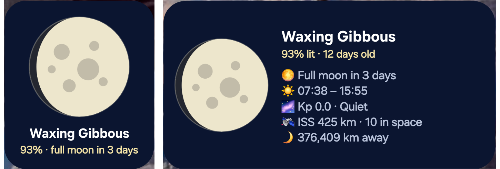
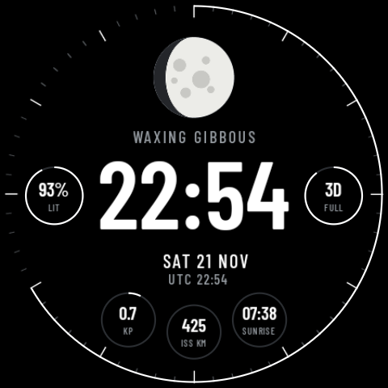

# MoonPhase for Android

A native Android app (Kotlin + Jetpack Compose, Material 3) ported from the
[MoonPhase](https://github.com/jamieharwood/MoonPhase) Spring Boot dashboard and its
[Ubuntu desktop port](https://github.com/jamieharwood/MoonPhase-uBuntu).
It shows the same astronomy data, computed on the device, and includes a **Wear OS watch app**
(Samsung Galaxy Watch 4 or newer, or any Wear OS 3+ watch) with a Tile and astronomy complications,
and the **MoonPhase Mission watch face**.

## Features

| Card | Contents |
|---|---|
| 🌙 **Moon Phase** | Phase name, an animated moon with a live terminator and twinkling stars (or the original ASCII art), illumination %, age, days to full moon, Earth–Moon distance |
| ☀️ **Solar System** | Mercury → Pluto distance from the Sun with light travel time, plus Earth→Mars/Jupiter/Saturn |
| 🚀 **Deep Space Probes** | Hubble, James Webb, Voyager 1 & 2, New Horizons, light time to the Voyagers |
| 🌍 **Earth** | Orbital speed, daylight hours, sunrise/sunset (UTC), axial tilt, NOAA aurora Kp index (shown in red during a storm) |
| 📅 **Upcoming Events** | Full moon, solstices, perihelion and aphelion, sorted by days remaining |
| 🛰️ **LEO** | ISS / Tiangong / Hubble altitudes from live TLEs, Starlink and Kuiper counts, total objects in orbit, ISS crew |
| 👨‍🚀 **People in Space** | Number of people on each spacecraft (★ = docked to ISS) |
| 📊 **Historical Data** | Chart of any of the 35 stored metrics over 7 days to all time, CSV export, *Populate past* backfill, reset |

Other features:

- **Units**: AU, km or miles (the toolbar button).
- **Refresh**: pull down on the dashboard or tap ⟳. Calculated values update every minute.
  Live feeds are cached (Kp for 15 minutes, LEO and crew for 6 hours).
- **Background refresh**: a WorkManager job runs about every 6 hours when online.
  It saves history (at most one snapshot per 12-hour UTC window, as in the original),
  sends notifications for aurora storms (Kp ≥ 5) and the full moon tonight or tomorrow, and pushes to Awtrix if enabled.
- **Settings**: location, history on/off and retention, notifications, Awtrix clock push.
- **Home-screen widgets**: long-press the home screen → *Widgets* → *MoonPhase*:
  - **Moon phase** (2×2): tonight's Moon, phase name, illumination and days to full moon.
  - **Sky tonight** (4×2): the Moon with its phase, % lit and age, the next full moon,
    sunrise–sunset in local time, aurora Kp (red during a storm) and, when taller, the ISS
    altitude, people in space and the Moon's distance.

  Both are resizable, open the app when tapped, redraw every hour, and update straight away
  when the app or the background job refreshes.

  
- Phones and tablets: cards reflow into columns on wide screens. Uses Material You colours on Android 12 and later.

Requires Android 8.0 (API 26) or later.

## Build and install

You need the Android SDK (platform 36, build-tools 36), from Android Studio or the
command-line tools. The build compiles with a **JDK 21** Gradle toolchain. Gradle finds
any installed JDK 21, including IntelliJ's `~/.jdks`, and downloads one automatically
if none is found. Your default `java` can be just a runtime (for example Ubuntu's
`openjdk-21-jre`).

```bash
git clone https://github.com/jamieharwood/MoonPhase-android.git
cd MoonPhase-android
echo "sdk.dir=$HOME/Android/Sdk" > local.properties   # or set ANDROID_HOME

./gradlew test                  # JVM unit tests for the calculations and parsers
./gradlew :app:assembleRelease  # phone → app/build/outputs/apk/release/app-release.apk (minified)
./gradlew :wear:assembleRelease # watch → wear/build/outputs/apk/release/wear-release.apk
```

Install on a phone with USB debugging enabled:

```bash
adb install -r app/build/outputs/apk/release/app-release.apk
```

Or copy the APK to the phone and open it (allow *Install unknown apps* for your file manager when prompted).

> Without a `keystore.properties` file the release build is signed with the local **debug** key
> so it installs straight away. To publish on Google Play, see [PUBLISHING.md](PUBLISHING.md)
> (upload key, app bundles, store listing, privacy policy and testing requirements).

## Project layout

```
core/src/main/java/io/github/jamieharwood/moonphase/      shared by phone and watch
  Astro.kt              deterministic calculations (ported from MoonPhaseModule/*.java)
  data/LiveFetcher.kt   NOAA Kp, TLE API, people-in-space feeds (cached; TLE requests one at a time)
app/src/main/java/io/github/jamieharwood/moonphase/       phone app
  MainActivity.kt       Compose activity, toolbar, dialogs, theme
  MainViewModel.kt      state, refresh, history, CSV export
  data/WearSync.kt      sends location/units to the watch
  data/History.kt       SQLite history store (original SnapshotDocument field names), CSV, backfill
  data/Background.kt    notifications and the periodic WorkManager refresh
  data/Awtrix.kt        optional Awtrix clock push
  data/Settings.kt      SharedPreferences settings
  ui/Dashboard.kt       the cards
  ui/Graphics.kt        Canvas-drawn moon and history chart
  ui/SettingsScreen.kt  settings
  widget/Widgets.kt     home-screen widgets (Jetpack Glance)
  widget/WidgetData.kt  widget data, moon bitmap, update-all
wear/src/main/java/io/github/jamieharwood/moonphase/wear/  watch app
  WearActivity.kt       Compose for Wear OS screen
  MoonTileService.kt    Tile
  MoonComplicationService.kt  moon phase complication
  AstroComplications.kt the other 12 astronomy complications
  WearSettings.kt       settings received from the phone
watchface/                                                 MoonPhase Mission watch face (Watch Face Format, no code)
  tools/generate.py     writes res/raw/watchface.xml, the 29 moon images, the dial and the preview
  src/main/res/font/    Barlow Condensed (SIL Open Font License, see FONT-LICENSE-OFL.txt)
core/src/test/…/AstroTest.kt, app/src/test/…/HistoryTest.kt  unit tests
```

## ⌚ Wear OS watch app

The `wear` module is a standalone watch app, installed separately from the phone app.

- **App**: moon disc, phase, illumination and age, then scrollable cards for the next full moon,
  sunrise/sunset and daylight, aurora Kp (red during a storm), ISS altitude and crew, people in
  space by spacecraft, Moon distance, upcoming solstices and apsides, Voyager 1, and Earth's speed.
  Tap **Refresh** at the bottom to reload the live data.
- **Tile**: swipe left from the watch face and add *Moon phase*. It shows the phase, an
  illumination ring and the days to full moon. Tap it to open the app.
- **Complications**: long-press your watch face → *Customise* → choose a complication slot →
  *MoonPhase*, then pick one of:

  | Complication | Shows | Ring |
  |---|---|---|
  | Moon phase | illumination and days to full moon, or the phase name | illumination |
  | Moon illumination | `93%` LIT | 0–100 % |
  | Days to full moon | `3D` FULL | through the cycle |
  | Moon age | `12D` AGE | 0–29.5 days |
  | Moon distance | `384k` MOON KM | perigee → apogee |
  | Next sunrise / sunset | `07:38` SUNRISE (local time) | |
  | Daylight hours | `8.3H` DAYLIGHT | 0–24 h |
  | Days to solstice | `30D` SOLSTICE | |
  | Earth orbital speed | `30.28` KM/S | aphelion → perihelion |
  | Voyager 1 distance | `169` VGR1 AU | |
  | Aurora Kp index* | `2.7` KP | 0–9 |
  | ISS altitude* | `418` ISS KM | |
  | People in space* | `10` IN SPACE | |

  \* needs the internet; shows "—" when the watch is offline. Distances follow the units set
  on the phone.
- **Settings from the phone**: when the phone app is installed, its location and units are sent
  to the watch over the Wear OS Data Layer. Open the phone app once to sync them. Without it,
  the watch uses Greenwich and AU.

The watch fetches live data over its own Wi-Fi/LTE, or through the phone over Bluetooth.

### Install on a Galaxy Watch

1. On the watch, open **Settings → About watch → Software information** and tap **Software version**
   five times to enable Developer options.
2. Open **Settings → Developer options**, turn on **ADB debugging** and **Wireless debugging**
   (the watch and this computer must be on the same Wi-Fi network).
3. In **Wireless debugging**, tap **Pair new device**, then on the computer run:

   ```bash
   adb pair <ip>:<pairing-port>      # enter the 6-digit code shown on the watch
   adb connect <ip>:<port>           # the address shown on the Wireless debugging screen
   ```

4. Build and install the watch app (use `-s <ip>:<port>` if the phone is also connected):

   ```bash
   ./gradlew :wear:assembleRelease
   adb -s <ip>:<port> install -r wear/build/outputs/apk/release/wear-release.apk
   ```

5. Turn **Wireless debugging** off again when you're done, because it drains the battery.

The phone and watch APKs share the package name `io.github.jamieharwood.moonphase` and must be
signed with the same key for settings sync to work. Building both on one machine takes care of this.

## 🚀 MoonPhase Mission watch face



A black-and-white, mission-control style digital watch face, in the `watchface` module:

- Large condensed digital time (12/24 h follows the watch), a seconds arc around the minute ring,
  the date, and a UTC readout.
- The Moon as it looks tonight (29 images, one per day of the cycle) and the phase name.
- Five complication slots. By default they show Moon illumination, days to full moon, aurora Kp,
  ISS altitude and the next sunrise/sunset from the MoonPhase watch app. When that app isn't
  installed they fall back to battery, date, steps and sunrise/sunset. Tap and hold the watch face
  → *Customise* to change any of them.
- Always-on mode dims everything and hides the seconds arc.

It uses Google's **Watch Face Format** (required for new watch faces on Play since January 2026),
so it has no code and needs Wear OS 4 or later. It is a separate app
(`io.github.jamieharwood.moonphase.watchface`), as Play requires. To change the design, edit
`watchface/tools/generate.py` and run `python3 watchface/tools/generate.py` (needs Pillow).

Install it on the watch (after pairing as above), then set it from the watch face picker, or:

```bash
./gradlew :watchface:assembleRelease
adb -s <ip>:<port> install -r watchface/build/outputs/apk/release/watchface-release.apk
adb -s <ip>:<port> shell am broadcast -a com.google.android.wearable.app.DEBUG_SURFACE \
  --es operation set-watchface --es watchFaceId io.github.jamieharwood.moonphase.watchface
```

## Differences from the web app

- No server, REST API or MongoDB connection. History is kept on the device in SQLite,
  using the same metric names, and can be exported as CSV.
- The Claude moon-phase cross-check is not included. The calculated phase was always the one displayed anyway.
- Cleartext HTTP is allowed only so a plain-HTTP Awtrix clock on the local network can be reached.
  Every data feed uses HTTPS.
